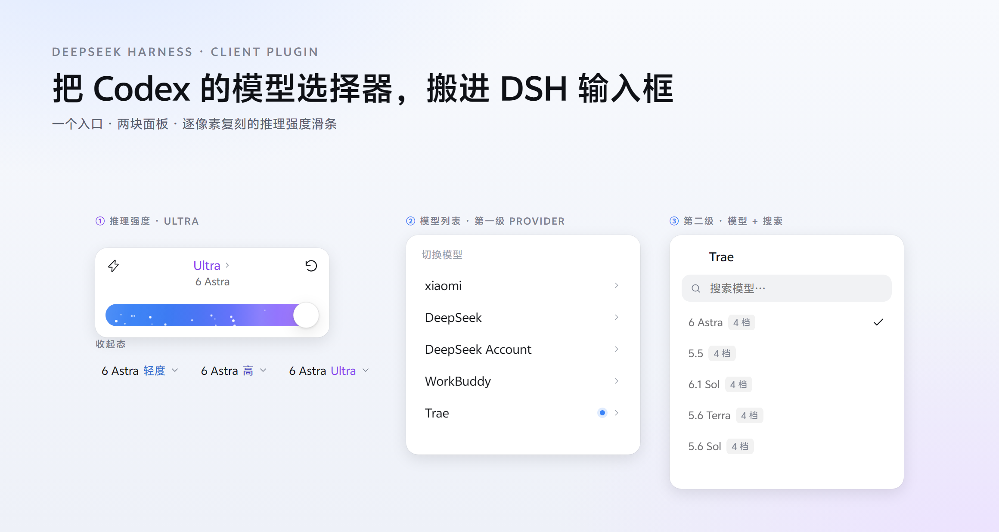
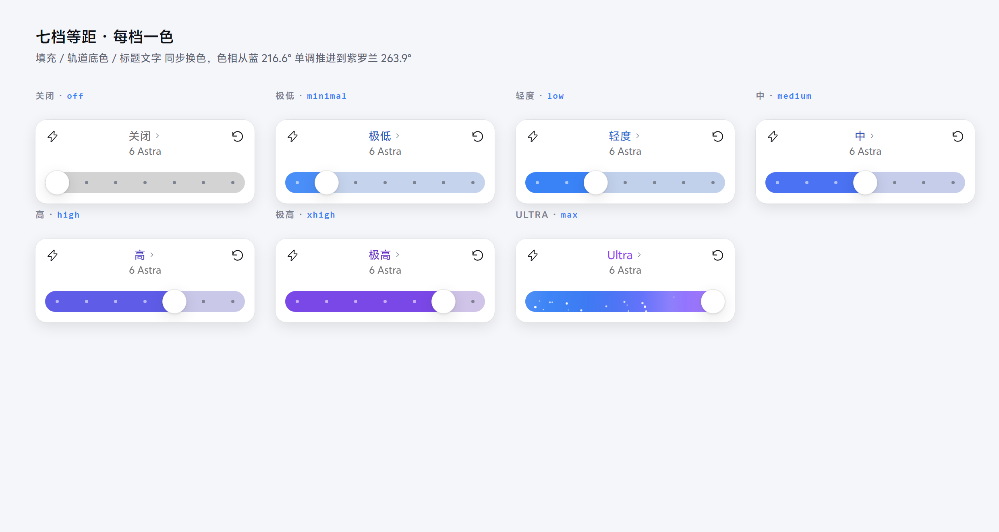
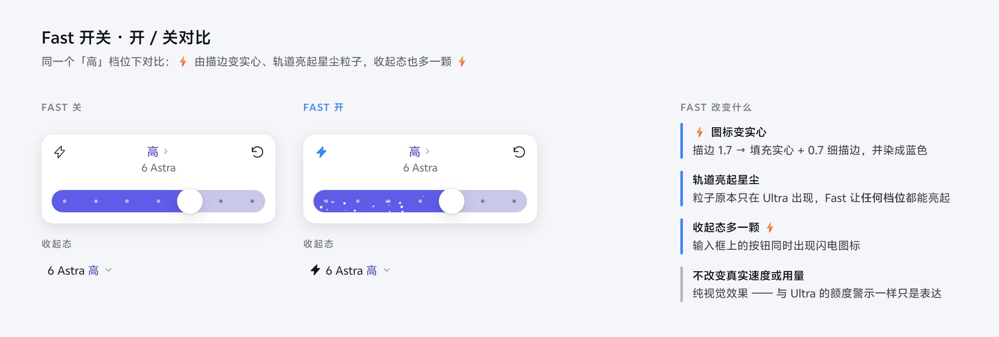
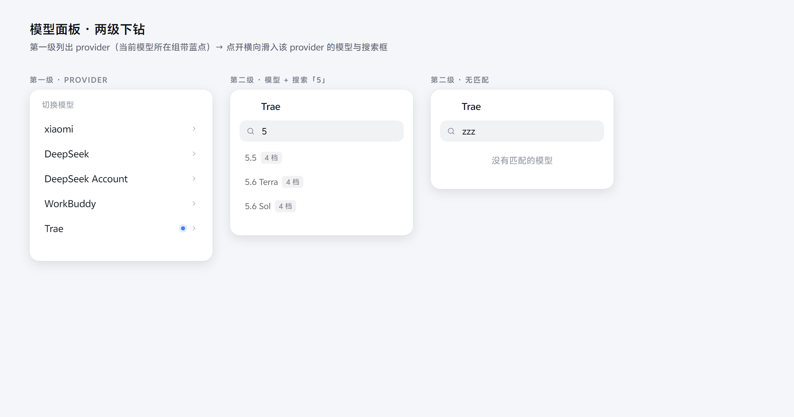
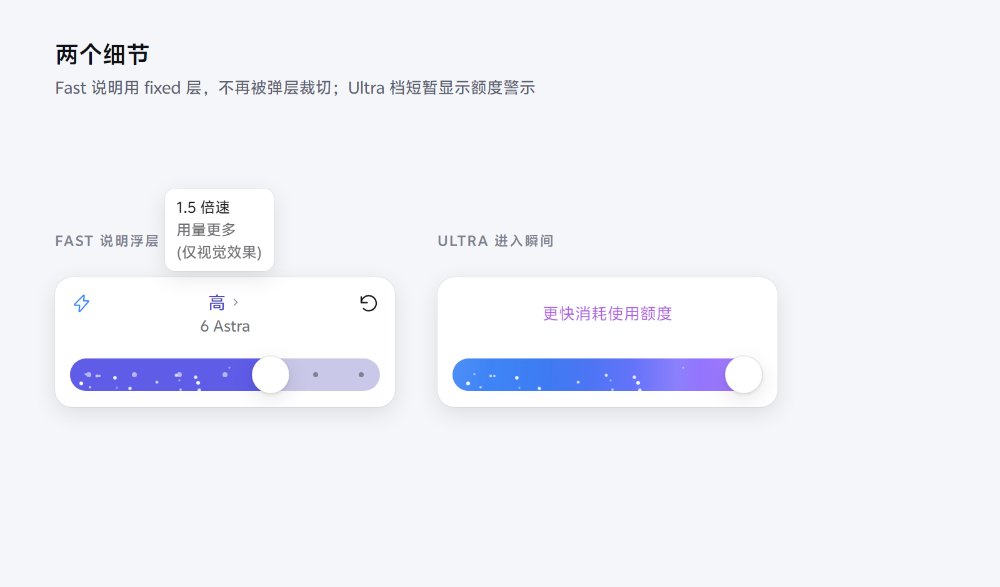
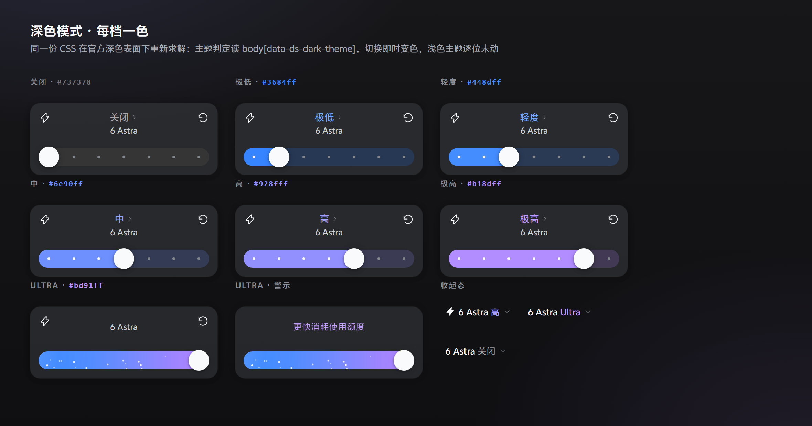

# dsh-codex-model-effort-selector

> 给 [DeepSeek Harness](https://github.com/deepseek-ai/deepseek-harness)（DSH）用的
> **Codex 桌面版风格「模型 + 推理强度」选择器**：
> 把输入框上那枚紧凑的模型席按钮，换成 Codex 风格的弹层 —— 一个入口，两块面板。




> 上图与本文所有截图都由 `client.js` 里**真实的 CSS 与类名**渲染而成
> （生成脚本 `test/make-readme-shots.mjs` 直接从源码抽取样式表，只替换 React 运行时），
> 不是手绘示意图。

[English](README.en.md) · **中文**

---

## 目录

- [这是什么](#这是什么)
- [功能](#功能)
- [安装](#安装)
- [使用](#使用)
- [兼容性与已知限制](#兼容性与已知限制)
- [开发](#开发)
- [项目结构](#项目结构)
- [文档](#文档)
- [常见问题](#常见问题)
- [致谢与许可](#致谢与许可)

---

## 这是什么

DSH 输入框上原本只有一枚很小的模型按钮。本插件用 `priority: -1` **接管**它，点开是一个 Codex 风格的弹层，里面是两块面板：

| 面板 | 内容 |
|---|---|
| **推理强度** | 逐像素复刻的 Codex 推理滑条：七档等距、每档一色、Ultra 亮起紫罗兰星尘 |
| **模型列表** | 按提供方分组的两级下钻列表（provider → 模型 + 搜索），行右侧带「N 档」徽标 |

一个入口同时管两件事，和 Codex 桌面版一致。

**几何不是「看着像」**：卡片高度、轨道位置与尺寸、旋钮直径、刻度点、行距全部由 **Codex 桌面版录屏的 93 帧**逐像素量出
（录屏缩放 1.385×，故 `CSS px = 录屏 px ÷ 1.385`），配色同样逐帧采样。完整测量数据见 [`docs/SPEC.md`](docs/SPEC.md)。

---

## 功能

### 推理强度面板



- **档位等距排列**：按模型**实际公布**的档位重排，模型有几档就显示几档。
  Codex 阶梯最多 7 档：`关闭 → 极低 → 轻度 → 中 → 高 → 极高 → Ultra`
- **每档一色**：填充、轨道底色、标题文字、收起态按钮**同步换色** ——
  色相从蓝 `216.6°` 单调推进到紫罗兰 `263.9°`，而不是只有 Ultra 特殊
- **拖动实时跟手**：拖动中旋钮连续跟指针（**不吸附**），松手才吸附到最近档。
  手势由 document 持有（不是指针捕获），拖到弹层外面再拖回来也不会中断
- **按压 / 释放形变**：按住旋钮会放大到 1.16 倍，松手沿回弹曲线弹回；**不加光环、不改阴影**，
  只缩放 `transform`，旋钮的布局盒不动，跟手计算不受影响
- **键盘**：`←/→` 或 `↑/↓` 移动一档，`Home`/`End` 到两端
- **Ultra 档**：轨道切换为紫罗兰流动渐变 + 22 颗星尘粒子，并显示「更快消耗使用额度」警示（1.8 秒）
- **抵达最右端 · 粒子绽放**：滑条落到右端那一档的瞬间，旋钮炸开一圈粒子（柔光环 + 18 颗光点），
  0.6–0.9 秒扩散淡出。凡是「从别的档位落到右端」都会触发；打开弹层时本来就停在右端则不会
- **Fast 开关**（⚡）：仅视觉效果，**不改变**实际速度或用量；悬停显示两行说明卡片
  （`1.5 倍速` / `用量更多`，「仅视觉效果」保留给读屏器）。**开关按会话记住** ——
  切换对话再切回来仍然是开，收起态也会带一颗 ⚡
- **重置**按钮：恢复模型默认档位（同时关闭 Fast）。provider 没公布默认值时落在**中间档**，
  所以每个 provider 组都真的会动

#### Fast 开关的开 / 关对比



同一个「高」档位下对比 —— ⚡ 由描边变实心、轨道亮起星尘粒子、收起态多一颗 ⚡，**全都不改变真实速度或用量**。

### 模型面板（两级下钻）



| 层级 | 内容 |
|---|---|
| **第一级** | provider 列表；**当前模型所在组在行右侧带一个蓝色小圆点**，每行只有 provider 名 + 蓝点 + 末尾一个右向雪弗龙 |
| **第二级** | 点 provider 后横向滑入：返回按钮 + provider 标题 + 搜索框 + 该 provider 的模型列表 |

- 每个模型行右侧带 **「N 档」徽标**；不支持推理的模型显示「不支持」并灰化，当前模型显示勾选标记
- **搜索**：大小写不敏感，支持**不连续字符按序匹配**（官方同款规则）
- **换模型落在中间档**：`floor(n/2)`，4 档 → 第 3 档；无档位的模型**整个不发** `reasoningEffort` 键
  （缺席 = 「对档位没意见」，与显式 `null` 不同）
- **provider 加载失败会如实列出**：接管官方席之后，官方那份逐 provider 的失败提示也归本插件负责，
  失败行显示「{name} 加载失败：{message}」，而不是一片空白
- `Escape` **逐层退避**：第二级 → 第一级 → 强度面板 → 关闭

### 两个容易忽略的细节



- **Fast 说明浮层必须渲染在弹层之外**：弹层要画官方菜单材质（`backdrop-filter`），
  而**非 `none` 的 `backdrop-filter` 会让弹层成为 `position:fixed` 子元素的包含块** ——
  浮层若还挂在弹层里，视口坐标会被当成相对弹层的坐标解释，再被 `overflow:hidden` 裁掉，
  表现就是「悬停完全没反应」。所以它是弹层的**兄弟节点**，显隐由 `pointerenter/leave` + `focus/blur` 驱动
- **Ultra 警示的时序**：**从非 Ultra 档进入 Ultra 的那一刻**，中列与左右两个工具按钮一起淡出、
  警示文字淡入并走一次扫光（1.1s，延迟 0.2s），**持续 1.8 秒**后自动淡回档位标题。
  也就是说警示是**立刻出现**、而不是等 1.8 秒才出现；
  期间停留在 Ultra 不会重复触发，一旦离开 Ultra 则**立即**恢复（不必等满 1.8 秒）
- **右端的旋钮是唯一抓手**：旋钮 30px、轨道 26px，旋钮上下各多出 2px。那 2px 若不可命中，
  按上去命中的就是面板、拖不动 —— 所以轨道上下各加了一条透明抓取带，把悬出部分一起纳入命中范围
- **拖动不能被「半路打断」**：旋钮保持 `pointer-events:none`，整段手势始终落在同一个目标（轨道）上；
  即使指针捕获被丢掉，document 捕获阶段的监听仍在驱动滑条，不会出现「按住到一半变成无法选中」

### 深色模式



与其他配图同一套排版、同一份真实 CSS，只是在官方深色表面下渲染：七档实渲染 + Ultra 警示态 + 收起态。深色主题下**整套配色按官方深色表面重新求解**：

- **主题判定读官方信号**：`<body>` 上的 `data-ds-dark-theme` 属性（官方主题启动脚本写入、官方深色 token 全挂在这选择器上），
  刻意**不用** `prefers-color-scheme` —— 用户固定选「深色」而系统是浅色时，媒体查询会与实际生效的色板相反。
  用 `MutationObserver` 订阅，在设置里切换主题**即时变色**，无需重载
- **七档全部重新求解**：v1.0.0 的浅色 ink 在深色卡片上全部跌破 AA（「高」档仅 1.83:1，几乎不可见）；
  深色表保留同一色相轴（蓝→紫），但亮度随档位**上升** —— 深色底上「更暗」意味着「更看不清」
- **轨道换成内嵌凹槽** `#232324`：浅灰 `#e8e7e8` 在深色卡片上是一条 11.3:1 的刺眼亮条
- **旋钮换成亮色圆钮**：原 token 在深色下解析成 `#2c2c2e`，与轨道几乎同色而消失
- **Ultra 警示扫光带反转**：浅色主题在紫罗兰底上扫一条深带，深色卡片上会掉到对比度以下，
  深色改成扫亮带；流动渐变 15 个色标也全部抬到轨道对比度之上
- 浅色主题**逐位未动**：两套色板由 `test/palette.mjs` 各自校验全部 WCAG 下限（24 项），
  并有回归断言防止浅色色值回流到深色表

### 无障碍与稳健性

- `role="slider"` + `aria-valuemin/max/now/valuetext`；弹层 `aria-expanded`/`aria-haspopup`/`aria-busy`，收起时 `inert`
- 每档填充色与文字色都过了 WCAG 对比度下限，**浅色/深色两套色板各验一遍**（`test/palette.mjs` 逐条断言）
- **深色模式**：见[上文专节](#深色模式) —— 官方信号判定、官方深色表面求解、切换即时变色
- **fail-open**：不注册任何宿主钩子、不发事件、不碰官方 class 与文字；
  任何一步认不出（目录未就绪、不是自己的会话、subagent 会话）就**什么都不做**，官方界面保持原样

---

## 安装

### 前置

- DSH `0.2.0-rc.2`（本插件按该版本的 slot 契约编写）
- **无需构建**：`client.js` 就是发布产物，手写、可读，便于静态审计

### 方式一：DSH Desktop 插件面板（推荐）

桌面版的 profile 由 Electron 独占管理，命令行装不了，请走面板：

1. 把本目录复制到本机任意位置（**安装后不要移动或删除**）
2. 打开 DSH Desktop → **设置 → 插件 → 添加插件**
3. 填入**本目录的完整路径**（不是 zip，也不是 `package.json`）
4. 勾选信任确认 → **安装** → **立即启用**
5. 若提示需要重启，**完全退出并重开** DSH Desktop（只关窗口不够）

### 方式二：命令行（仅非 desktop profile）

```powershell
dsh plugin --profile web add link:"<本目录的绝对路径>"
dsh --profile web --dump-config    # 确认出现 dsh-codex-model-effort-selector
```

### 验证已生效

重开 DSH 后，点开输入框下方的模型名 —— 应该展开成「推理滑条 + 模型列表」的 Codex 风格弹层。

```powershell
dsh plugin --profile desktop list | Select-String codex-model-effort
```

### 升级与卸载

- **升级**：面板里重装 / 重新指向新目录，然后**完全退出并重开** DSH Desktop。
- **卸载**：面板卸载；手工装的用
  `dsh plugin --profile <profile> remove dsh-codex-model-effort-selector`。
- ⚠️ **不要**用 `Remove-Item -Recurse` 删 junction（可能顺着链接删掉插件本体）。

---

## 使用

**收起态**（输入框右侧，就一颗按钮，同样带档位色）：

```
[ ⚡ 6 Astra  Ultra  ⌄ ]
```

**点开**后：

| 操作 | 结果 |
|---|---|
| 拖滑条 / 点轨道 | 改档位；拖动期间连续跟手，松手吸附到最近档 |
| `←/→` `↑/↓` / `Home` `End` | 键盘改档 |
| 点中间的档位标题 | 翻到模型列表第一级 |
| 点 provider 行 | 横向滑入该 provider 的模型列表（带搜索框） |
| 点某个模型 | 切换模型并回到强度面板，档位落在**中间档** |
| `Esc` | 逐层退避：第二级 → 第一级 → 强度面板 → 关闭 |
| ⚡ | Fast 视觉开关（仅视觉效果） |
| ↻ | 重置为模型默认档位 |

---

## 兼容性与已知限制

| 项 | 说明 |
|---|---|
| DSH | 已在 **DSH Desktop 0.2.1-rc.2（Windows）** 实机验证；`0.2.0-rc.2` 仍可用（`renderSlot` 缺失时回退） |
| 运行时依赖 | **无**（`client.js` 手写，零构建、零第三方代码） |
| 主题 | 跟随 DSH 主题令牌（`--dsw-*`），令牌缺失时回退到中性灰 + `#4d93f8` 蓝 |
| 平台 | Windows 实机验证；其余平台未测 |

- **需要重启** DSH Desktop 才生效（客户端 bundle 在启动时注入）
- **依赖官方 slot 契约**：官方若改动 `conversation.input.model` 的形状，本插件会**静默退回**「什么都不做」，不会破坏官方界面
- **0.2.1 起席位要声明子槽位**：`conversation.input.model.label` 只在**声明它的条目挂载期间**存在，
  官方模型列表与「1017」徽标都往它注册。本插件遮蔽席位时**同样声明并渲染**该子槽位，
  否则那些装饰会在无报错的情况下消失
- **官方模型菜单没有入口了**：那颗席按钮是官方菜单的唯一入口，被遮蔽后打不开；切模型仍有本插件面板与官方 **`/model` 命令**两条路
- **档位由模型决定**：滑条只显示当前模型实际公布的推理强度；模型没有推理元数据时显示「此模型未提供推理强度」
- **Ultra 命名**：`max` 档在 Codex 里叫 Ultra，本插件沿用该命名；若某模型把最高档命名为别的 id，则显示模型自己的名字
- **模型列表顺序以宿主目录为准**：目录没列到的模型，面板里也看不到

---

## 开发

包本身**零依赖**，不需要 `npm install`：

```powershell
# 语法检查
node --check client.js

# 离线断言套件（43 项：加载 / 注册契约 / 遮蔽 / 几何 / 配色 / 主题接线 / fail-open / 无障碍 / 两级下钻 / 悬浮窗 / 绽放 / 形变 / 抓手 / 0.2.1 子槽位）
node test/verify.mjs

# 配色断言（24 项：浅色 + 深色各过一遍三条 WCAG 下限 + 色相单调 + 色度 + 去重）
node test/palette.mjs

# 折叠 bug 回归（6 项：同时跑有 bug 与修好后的两个状态机）
node test/collapse-regression.mjs

# 对着真实 DSH 的集成测试（9 项；0.2.1 对着随包源码断言子槽位契约，找不到 DSH 安装时自动跳过）
node test/slots-integration.mjs
# 自定义 DSH 安装位置：设置 DSH_ASAR 或 DSH_RESOURCES 环境变量

# 编码守卫（23 项：所有文本文件必须是无 BOM 的干净 UTF-8）
node test/encoding.mjs

# 重新生成 README 截图（从 client.js 抽取真实 CSS；需要 Edge/Chrome）
node test/make-readme-shots.mjs

# 生成浏览器预览页（同样抽取真实 CSS，浅色/深色并排）
node test/make-preview.mjs   # 然后打开 test/preview.html

# 重新生成深色模式对比图（浅色 vs 深色，真实 CSS 无头渲染）
node test/make-dark-shot.mjs   # 输出 docs/images/dark-mode.png
```

几个测试台的设计值得说明：

- `test/verify.mjs` 会**真正执行** `client.js`，捕获它注册的 slot，并断言注册形状与官方文档一致
- `test/palette.mjs` 从源码里**读出**真实色值再算对比度，色值一改就会重新校验
- `test/collapse-regression.mjs` 把**有 bug 的状态机**也实现了一遍：先证明它确实会「一次全开」，再证明修好后的版本不会 —— 回归测试不该只测好版本
- `test/slots-integration.mjs` 从 `app.asar` 里**解包出真实的 SlotCore**，用本插件真实的注册定义驱动它，端到端验证遮蔽与卸载恢复

---

## 项目结构

```
client.js                  发布产物：浏览器 bundle，手写、零构建、可静态审计
index.js                   宿主半边，空实现 —— 只为让本包成为 cordis 树上的节点
cordis.patch.yml           把本包 insert 进 profile 的组合层
package.json               声明 dsh.bundle.patch 与 dsh.client（含 inject 依赖）
locale/{zh,en}.json        插件在插件管理页里的标题与描述
icon.svg                   插件图标
docs/                      架构、事故复盘、像素规格与本文截图
test/                      离线断言 + 配色断言 + 折叠回归 + 真实 SlotCore 集成 + 截图生成器
```

---

## 文档

| 文档 | 内容 |
|---|---|
| [docs/ARCHITECTURE.md](docs/ARCHITECTURE.md) | 怎么实现的：席位接管、状态机、几何、色彩、粒子数学、无障碍、测试台策略 |
| [docs/INCIDENTS.md](docs/INCIDENTS.md) | **事故复盘**：现象 → 根因 → 修法 → 断言。界面不对时先翻这份 |
| [docs/SPEC.md](docs/SPEC.md) | 逐像素测量规格与复刻保真度对照（原版 vs 本插件） |
| [CHANGELOG.md](CHANGELOG.md) | 逐版改动 |

---

## 常见问题

**装完没反应？**
先**完全退出并重开** DSH Desktop（不是关窗口）。还不行就检查插件详情页有没有报错行 ——
宿主读 `package.json` 是直接 `JSON.parse`，清单有问题（例如 BOM）会让整包被丢弃，界面毫无反应。

**点开还是官方那个模型菜单？**
说明本插件没被加载。确认 profile 里确实启用了本插件，并且**完全重启**过 DSH Desktop。
本插件用 `priority: -1` 遮蔽官方席位，`test/slots-integration.mjs` 会对着真实 SlotCore 断言这一点。

**面板说「宿主没有列出任何 provider」？**
这句说明**宿主的模型目录是空的** —— 不是插件的问题：官方 `/model` 命令此刻同样是空的。
去 DSH 的**设置 → 模型 / 账号**看：通常是没有可用 provider，或账号拿不到令牌。

**面板说「还没有会话 —— 发一条消息后就能选模型」？**
你正停在「新会话」的空白壳上，输入区此时还没有会话 id。发一条消息、或打开一个已有会话即可。

**滑条显示的档位和我预期的不一样？**
滑条只显示**当前模型实际公布**的档位。模型没提供推理元数据时，面板会写「此模型未提供推理强度」。

---

## 致谢与许可

- 模型列表的交互参照了 [Bai-2008/a-better-dsh-codex-effort-slider](https://github.com/Bai-2008/a-better-dsh-codex-effort-slider)
  的**两级下钻**实现（本插件据此取代了早期自相矛盾的折叠集合方案）。
- 原版几何与配色以 Codex 桌面版录屏为第一手依据，并与其他社区的 Codex 滑块移植版交叉验证，
  详见 [`docs/SPEC.md`](docs/SPEC.md) 的证据来源一节。
- 目标宿主是 [deepseek-ai/deepseek-harness](https://github.com/deepseek-ai/deepseek-harness)，
  本插件只使用它的公开面（槽位、`modelDirectories` 服务与语义 DOM 锚点）。
- 许可 **MIT**（见 [LICENSE](LICENSE)）。**无可选第三方代码**：闪电标 / 雪弗龙是自己画的路径，
  粒子层与全部 CSS 均为手写。
