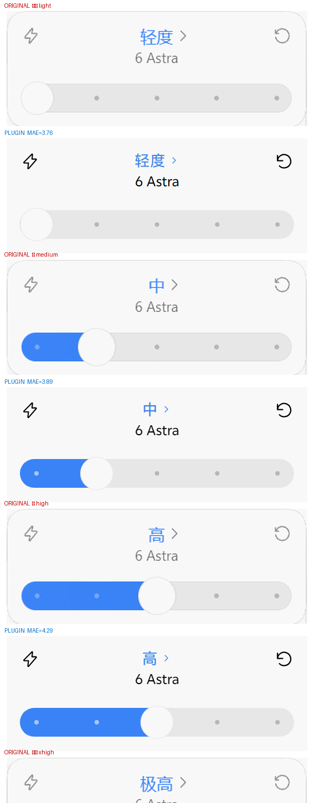
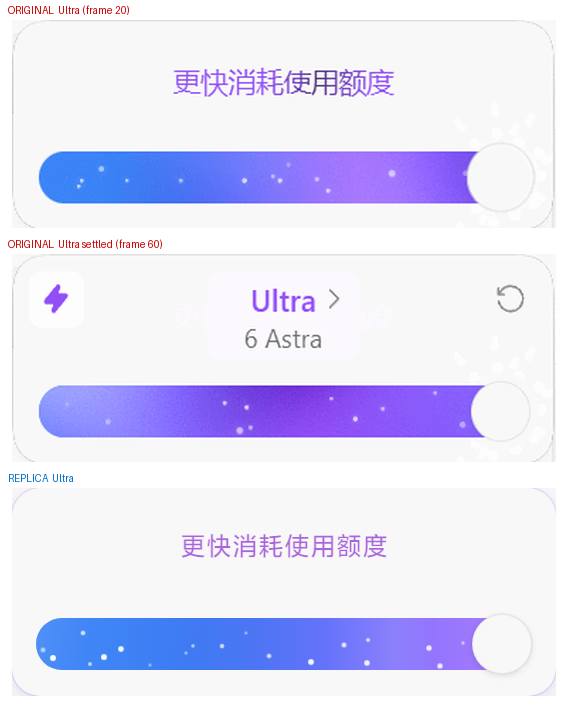

# 像素规格 · Codex 推理滑块复刻

> 本文所有尺寸与配色均为**逐帧实测**，不是估算值。每个数字都注明了来源。
>
> 架构与实现见 [ARCHITECTURE.md](./ARCHITECTURE.md)；缺陷因果链见 [INCIDENTS.md](./INCIDENTS.md)。

---

## 0. 结论速览

| 项目 | 结论 |
|---|---|
| 原版载体 | Codex 桌面版（macOS/Windows）输入框上方的 **popover 弹层**，挂在模型席按钮上 |
| 档位数 | 原版 **5 档等距**：`轻度 → 中 → 高 → 极高 → Ultra` |
| 旋钮行程 | `pct = 0 / 0.25 / 0.50 / 0.75 / 1.00`（实测 0 / .249 / .502 / .751 / 1.001） |
| 轨道尺寸 | 248 × 26 px，圆角 16px，底色 `#e8e7e8` |
| 旋钮尺寸 | 直径 30px 正圆（比轨道高 4px），圆心行程 `calc((100% − 30px) × pos)` |
| 填充规则 | 宽 `calc((100% − 30px) × pos + 15px)` — **恰好止于旋钮圆心** |
| 常态色 | 填充与标题同为 `#3a83f7`（蓝） |
| Ultra 色 | 蓝→紫罗兰流动渐变，标题/警示转 `#914ef6`，刻度点隐去，星尘粒子亮起 |
| 动画 | 拖动实时跟手，松手吸附；过渡 `.18s cubic-bezier(.2,.8,.2,1)` |

**可运行的原型**：[`docs/prototype.html`](./prototype.html) —— 浏览器打开即可拖动、切深浅色、切 4/2/6 档。

### 本插件与原版的一处有意差异

原版固定 5 档；本插件**按模型实际公布的档位**渲染，因此本机实测常见 **7 档**
（`关闭 / 极低 / 轻度 / 中 / 高 / 极高 / Ultra`），并**每档一色**（原版只有 Ultra 特殊）。
刻度点数、吸附点数、色相推进都随档数自适应；几何公式与配色下限不变。

---

## 1. 证据来源

### 1.1 原版录屏（最高可信度）

| 来源 | 说明 |
|---|---|
| `refs/original-codex-slider.gif` | **原版 Codex 滑块录屏，523×468，93 帧**。来自社区仓库 `bakabaicai/DSH-Codex-reasoning-effort-slider` 的 `gif/Codex.gif`（README 明确标注为「Codex 原版」） |

> 该录屏是本次复刻的**第一手依据**。下面所有几何与配色都由这 93 帧逐像素测量得出。

### 1.2 参考实现（规格交叉验证）

| 仓库 | 角色 | 关键价值 |
|---|---|---|
| [bakabaicai/DSH-Codex-reasoning-effort-slider](https://github.com/bakabaicai/DSH-Codex-reasoning-effort-slider) | **自称 1:1 移植** | 提供完整 CSS（`client.js` 内联样式表），尺寸与实测值吻合 |
| [HanaAyane/dsh-reasoning-effort](https://github.com/HanaAyane/dsh-reasoning-effort) | 独立设计路线 | 带正式 `design/visual-spec.md`，但**走的是自研视觉**（辐射/流光），不是原版复刻 |
| [Microqian2th/dsh-codex-effort-slider](https://github.com/Microqian2th/dsh-codex-effort-slider) | Codex 风格改造 | README 含大量几何/色彩推导（旋钮顶头适配、刻度点 5px→3px 等），可作旁证 |
| [edwardzhou21/dsh-reasoning-slider](https://github.com/edwardzhou21/dsh-reasoning-slider) | 内嵌模型选择器 | 参考其 DOM 桥接思路 |
| [Bai-2008/a-better-dsh-codex-effort-slider](https://github.com/Bai-2008/a-better-dsh-codex-effort-slider) | 模型列表两级下钻 | 本插件的**模型面板**交互参照该实现 |

**交叉验证结果**（实测值 vs `bakabaicai` 的 CSS 声明）：

| 元素 | 实测（GIF px） | ÷1.385 | 参考实现声明 | 一致性 |
|---|---|---|---|---|
| 卡片高度 | 144 | **104.0** | `104px` | ✅ |
| 轨道顶部偏移 | 91 | **65.7** | `top:65px` | ✅ |
| 轨道高度 | 36 | **26.0** | `height:26px` | ✅ |
| 轨道宽度 | 346 | **249.8** | `248px`（`100% − 24px`） | ✅ |
| 旋钮直径 | 40 | **28.9** | `30px` | ≈ |
| 卡片宽度 | 384 | **277.3** | `272px` | ≈ |
| 刻度点直径 | ~5 | **~3.6** | `4px` | ✅ |
| 图标命中区 | 39 | **28.2** | `28px` | ✅ |
| 图标顶部 | 10 | **7.2** | `top:7px` | ✅ |
| 席按钮高度 | 39 | **28.2** | `height:28px` | ✅ |

> 换算比例 **1.385×** 由多个独立元素共同验证，可信。

### 1.3 官方行为说明

- [openai/codex issue #31968](https://github.com/openai/codex/issues/31968) — 官方 App 的 Advanced「power slider」实现细节（含档位序列、`max` 被跳过的已知问题）。注意：**该 issue 描述的是 Advanced 面板的跨模型 power slider，与本文复刻的「挂在模型席上的推理滑块」不是同一个控件**，但可作为官方档位命名的佐证。

---

## 2. 几何规格（精确值）

### 2.1 结构分解

```
┌──────────────────────────────────────────────┐  ← popover 272×104, r=14
│  ⚡                   轻度 ›              ↻   │  ← header 56px
│                       6 Astra                │     左/右 28×28 命中区, top 7px
│                                              │     中列 left/right 43px, top 8px
│  ┌────────────────────────────────────────┐  │  ← rail: left/right 12px, top 65px
│  │●━━━━━━━━━━━━━━━━━━━━━━━━━━━━━━━━━━━━━━│  │     h=26, r=16, bg #e8e7e8
│  └────────────────────────────────────────┘  │
└──────────────────────────────────────────────┘
```

### 2.2 逐元素参数

| 元素 | 属性 | 值 | 备注 |
|---|---|---|---|
| **popover** | 宽 × 高 | `272 × 104 px` | 实测 277.3 × 104 |
| | 圆角 | `14px` | |
| | 底色 | `#f8f8f8` | 与页面底色相同，靠阴影分层 |
| | 阴影 | 分层：`0 0 0 .5px rgba(0,0,0,.05)` + `0 5px 18px rgba(0,0,0,.10)` | |
| **header** | 高 | `56px` | |
| | 左侧工具（⚡） | `28×28`，`top:7px`，`left:7px`，圆角 `8px` | 图标 `16px` |
| | 右侧工具（↻） | `28×28`，`top:7px`，`right:7px`，圆角 `8px` | 图标 `16px` |
| | 中列（标题+模型） | `left:43px; right:43px; top:8px; height:42px` | 点击下钻模型列表 |
| | 标题 | `14px / line-height 20px`，居中 | 右侧 `10px` 雪弗龙 |
| | 模型名 | `12px / line-height 18px`，`#707073` | 单行省略 |
| **rail** | 定位 | `left:12px; right:12px; top:65px` | 实测内缩 9.5px→取 12 |
| | 尺寸 | `height:26px`，圆角 `16px` | |
| | 底色 | `#e8e7e8` | 本插件按当前档位色**混入 22%** 着色 |
| **fill** | 宽度 | `calc((100% − 30px) × pos + 15px)` | 止于旋钮圆心 |
| | 圆角 | `16px 0 0 16px` | |
| | 常态色 | `#3a83f7` | 本插件按档位取色 |
| **knob** | 尺寸 | `30 × 30 px`，`border-radius:50%` | 正圆，比轨道高 4px |
| | 定位 | `left:calc((100% − 30px) × pos); top:-2px` | 圆心行程 15px…(w−15px) |
| | 底色 | `#f8f8f8` | 与卡片同色 |
| | 边框 | `.5px solid rgba(0,0,0,.07)` | |
| **dot** | 尺寸 | `4 × 4 px`，圆角 `50%` | 实测 ~3.6px |
| | 定位 | `top:11px; left:calc((100% − 30px) × tick + 15px); margin-left:-2px` | 与旋钮共用几何 |
| | 未达色 | `#b6b6b8` | |
| | 已达色 | `rgba(255,255,255,.55)` | |
| **warning** | 定位 | `left:29px; right:29px; top:20px` | Ultra 时替换 header |
| | 字号 | `13px / line-height 18px` | 居中 |

### 2.3 关键几何公式（三者共用一套内缩）

```css
/* 旋钮、填充终点、刻度点共用同一几何 —— 这是原版"顶头适配"的核心 */
knob:  left: calc((100% - 30px) * pos);
fill:  width: calc((100% - 30px) * pos + 15px);
dot:   left: calc((100% - 30px) * tick + 15px);
```

**为什么是 `30px`**：旋钮直径 = 30px，圆心只能在 `[15px, 宽度−15px]` 之间移动，
这样 `pos=0` 时圆心落在左端圆角内、`pos=1` 时落在右端圆角内，**圆永远是完整的圆**
（否则圆心跑出轨道两端，圆会被 `overflow:hidden` 切成半圆或方块）。

---

## 3. 配色规格（精确值）

### 3.1 实测色板

| 名称 | 值 | 用途 | 采样点 |
|---|---|---|---|
| `page-bg` | `#f8f8f8` | 页面底色 | `(20,20)` |
| `card-bg` | `#f8f8f8` | 卡片与旋钮底色 | `(250,300)` / `(112,352)` |
| `rail-bg` | `#e8e7e8` | 轨道未填充段 | `(400,352)` |
| `dot` | `#b6b6b8` | 刻度点（未达） | `(189,352)` |
| `fill-blue` | `#3a83f7` | 填充 + 标题（常态） | 多帧众数，n=15536 |
| `title-blue` | `#3a83f7` | 标题文字 | 众数 n=442 |
| `title-violet` | `#914ef6` | Ultra 标题 + 警示文字 | 众数 n=4292 |
| `label-secondary` | `#707073` | 模型名、工具图标 | 标题带最暗像素 |
| `label-primary` | `#15171b` | 主文字 | — |

### 3.2 每档一色（本插件的扩展）

原版只有 Ultra 特殊。本插件把**填充 / 轨道底色 / 标题文字**都按档位取色，
色相从蓝 `216.6°` **单调推进**到紫罗兰 `263.9°`：

| 档 | 填充 | 标题 ink |
|---|---|---|
| `off` | `#8a8a8f` | `#707073` |
| `minimal` | `#4a8ef8` | `#2b62bd` |
| `low` | `#3a83f7` | `#2f6fd0` |
| `medium` | `#4a72f2` | `#3a55b8` |
| `high` | `#5f5ce8` | `#4a3fc0` |
| `xhigh` | `#7b48e8` | `#6a35c8` |
| `max` | `#914ef6` | `#8b46ee` |

**排序轴是色相，不是亮度**：紫罗兰天生比蓝暗，若强行要求「越往右越暗」，
`max` 就必须往粉色去、不再像 Ultra。`test/palette.mjs` 断言的是**色相单调**与三条对比度下限，
不是亮度单调。

### 3.3 WCAG 对比度下限（`test/palette.mjs` 逐条断言）

| 约束 | 下限 | 实测最低 |
|---|---|---|
| 填充 vs 未填充轨道 | ≥ 2.5 | 2.61 |
| 白色旋钮 vs 填充 | ≥ 2.2 | 2.79 |
| 标题文字 vs 卡片底 | ≥ 4.5 | 4.59 |

`极低` 档**不能**用真正的浅蓝：比 `#4a8ef8` 更浅就会掉到轨道对比度 2.5 以下，
在浅色轨道上糊成一片。「低能量感」因此靠**色相与饱和度**表达，而不是靠亮度。

### 3.3b 深色模式色板（v1.0.1 新增）

上表只对浅色表面成立。深色主题下同一套 ink 会全部跌破 AA（「高」档 `#4a3fc0` 在深色卡片
`#2a2b2e` 上仅 1.83:1），所以另有一套按官方深色表面解出的 `EFFORT_FILL_DARK`/`EFFORT_INK_DARK`：

| 档位 | 填充（深色） | 标题 ink（深色） |
|---|---|---|
| `off` | `#737378` | `#a9a9ae` |
| `minimal` | `#3684ff` | `#73a9ff` |
| `low` | `#448dff` | `#76aafe` |
| `medium` | `#6e90ff` | `#8ba7ff` |
| `high` | `#928fff` | `#a4a2ff` |
| `xhigh` | `#b18dff` | `#bc9cff` |
| `max` | `#bd91ff` | `#c39bff` |

深色表面取自 `@deepseek-ai/dsh-client-ui-theme`：卡片 `--dsw-specific-menu`（`#43454a73`
叠在 `#151517` 上 ≈ `#2a2b2e`）、轨道 `--dsw-alias-bg-layer-1`（`#232324`）、
旋钮 `--dsw-alias-label-primary`（`#f9fafb`）。色相轴与浅色一致（216°→264°），
但亮度随档位**上升**（0.245 → 0.383）：深色底上「更暗」意味着「更看不清」，
浅色里「加深 = 更用力」的隐喻只能翻过来。主题判定读 `<body>` 的 `data-ds-dark-theme`
（官方信号），不读 `prefers-color-scheme`——固定偏好下媒体查询与实际色板相反。

### 3.4 Ultra 填充渐变（20 点实测）

在 frame 20 的轨道中线逐点采样（去掉粒子噪声后取纵向均值）：

```
 0%  #3b83f6   10%  #3b82f6   20%  #3d7bf3   30%  #4c75f4
40%  #6473fa   50%  #8d80fc   55%  #9375fd   60%  #9d78fd
65%  #a779fe   70%  #a476fe   75%  #9e73fe   80%  #9166fe
85%  #845af9   93%  #7d55f6  100%  #7448ee
```

**形状**：从蓝 `#3b83f6` 平滑爬升到最亮的紫罗兰 `#a779fe`（约 70% 处），
然后**回落变深**到 `#7448ee`。**不是单调渐变** —— 这是原版「能量感」的关键。
做成单调渐变会明显不像。这 15 个停靠点原样写进了 `client.js` 的 `.cmes-popover.peak .cmes-fill`。

### 3.5 Ultra 附加动效

| 效果 | 参数 |
|---|---|
| 渐变流动 | `background-size:155% 100%` + `colorflow 3.8s ease-in-out infinite alternate` |
| 扫光 | `::before` 斜向白色高光，`shimmer 4.5s ease-in-out infinite alternate`，`translateX(−45%)→45%` |
| 星尘粒子 | 22 颗，`3px` 白点，横穿轨道；亮度 0.5–1.0 确定性伪随机 |
| 警示文字扫光 | `sweep 1.1s linear .2s 1 both`，`background-position 100%→0%` |
| 刻度点 | `opacity:0`（隐去） |

**粒子高度解耦**（Microqian2th 实测反馈）：高度不能和相位取同一个数，
否则「越靠右的星越高」，22 颗会排成一条斜线（实测相关系数 0.999）。
本插件用**哈希排序的高度** + **黄金比相位**，相关系数约 −0.11。

---

## 4. 状态机

### 4.1 档位定义（原版 5 档）

| # | 文案 | pct | 填充 | 标题 | 刻度点 | 粒子 |
|---|---|---|---|---|---|---|
| 0 | 轻度 | 0.00 | 蓝 `#3a83f7` | 蓝 | 全显 | 无 |
| 1 | 中 | 0.25 | 蓝 | 蓝 | 1 个已达 | 无 |
| 2 | 高 | 0.50 | 蓝 | 蓝 | 2 个已达 | 无 |
| 3 | 极高 | 0.75 | 蓝 | 蓝 | 3 个已达 | 无 |
| 4 | **Ultra** | 1.00 | **紫罗兰渐变** | **紫 `#914ef6`** | **隐去** | **亮起** |

本插件把档数放宽到模型公布的任意档数：`pct` 与刻度点按 `i / (n − 1)` 重算，Ultra 判定**按 id**（`max` / `ultra`）。

### 4.2 Ultra 进入时的界面切换

进入 Ultra 时，原版**整个 header 被替换**：

```
常态:  ⚡    [ 轻度 › ]     ↻
             6 Astra

Ultra: ⚡    [更快消耗使用额度]    ↻     ← 中列淡出，警示文字淡入
           （6 Astra 同时淡出）
```

- `.popover.ultra .mid, .popover.ultra .tool { opacity:0 }`
- `.popover.ultra .warning { opacity:1 }`
- 警示文字走扫光动画（1.1s + 0.2s 延迟，一次性）

**时序**：从**非** Ultra 档进入 Ultra 的瞬间立即显示，`setTimeout` **1800ms** 后自动淡回档位标题；
停留在 Ultra 不会重复触发，离开 Ultra 立即清除（不等满 1.8s）。

### 4.3 收起态（composer seat）

| 属性 | 值 |
|---|---|
| 高度 | `28px` |
| 内边距 | `0 7px` |
| 圆角 | `8px` |
| 间距 | `gap:5px` |
| 字号 | `13px` |
| 闪电图标 | `14 × 16 px` |
| 档位文字 | 常态 `#707073`；**Ultra 时 `#9c4ce3`** |
| 雪弗龙 | `12px` |

收起态**同步显示当前档位**（Ultra 时档位文字变紫），所以点开菜单之前就能看出强度。

---

## 5. 交互规格

| 行为 | 规格 |
|---|---|
| **拖动** | 指针按下即跳档；移动时实时跟手（`transition:none`）；松手吸附到最近档 |
| **吸附** | `idx = round(clamp((x − left − 15) / (width − 30), 0, 1) × (n − 1))` |
| **点击** | 点击轨道任意位置直接跳到该档 |
| **键盘** | `←/→` 或 `↑/↓` 移动一档；`Home`/`End` 到两端 |
| **过渡** | 非拖动时 `left`/`width` 走 `.18s cubic-bezier(.2,.8,.2,1)` |
| **焦点环** | `outline:2px solid #3989e9; outline-offset:2px` |
| **无障碍** | `role="slider"` + `aria-valuemin/max/now` + `aria-label` |
| **减少动态** | 粒子周期 ×2.6（放缓而非冻结 —— 冻结会让「能量在流动」的表达消失） |
| **Fast 开关** | 仅改变视觉动画，不影响实际速度或用量 |

---

## 6. 复刻验证

### 6.1 逐档 1:1 对照

用无头 Edge 渲染原型（`?bare=1&i=N`），与原版帧同尺寸 1:1 对比：



Ultra 档单独对照（进入瞬间的警示态 + 稳定态）：



### 6.2 量化指标

**轨道带像素差（MAE，0–255）**：

| 档位 | MAE |
|---|---|
| 轻度 | **1.71** |
| 中 | **3.67** |
| 高 | **4.41** |
| 极高 | **5.28** |
| Ultra | 11.93 |

> 蓝档 MAE 1.7–5.3 —— 主要来自 GIF 有损压缩与抗锯齿差异，几何本身已对齐。
> Ultra 偏高是因为粒子动画的相位不可能与录屏逐帧同步。

**刻度点归一化位置**：

| 点 | 原版 pct | 复刻 pct | 偏差 |
|---|---|---|---|
| 1 | 0.249 | 0.248 | −0.001 |
| 2 | 0.502 | 0.498 | −0.004 |
| 3 | 0.751 | 0.747 | −0.004 |
| 4 | 1.004 | 0.997 | −0.007 |

**复刻件实测尺寸**（从渲染截图反测）：

| 元素 | 复刻实测 | 规格 | 结论 |
|---|---|---|---|
| 轨道 | `x[12,260]` → 248px | 248px | ✅ |
| 轨道高 | `y[65,91]` → 26px | 26px | ✅ |
| 旋钮直径 | 30px | 30px | ✅ |
| 刻度点 | 4px，pct 0.248/0.498/0.747/0.997 | 等距 5 档 | ✅ |

---

## 7. 与原版的已知差异（如实标注）

| 项 | 原版 | 本插件 | 说明 |
|---|---|---|---|
| 档数 | 固定 5 档 | 跟随模型公布档数（本机实测 7） | 有意扩展；几何与配色下限不变 |
| 每档配色 | 只有 Ultra 特殊 | 每档一色，色相单调 | 有意扩展，见 3.2 |
| 卡片宽度 | 277.3px（实测） | 272px | 取参考实现的整数值，差 5px（1.8%） |
| 旋钮直径 | 28.9px（实测） | 30px | 取参考实现的整数值 |
| 星尘粒子 | 相位不可复现 | 确定性伪随机 | 录屏无法提取原始随机种子 |
| 字体 | macOS 系统字体 | Segoe UI / PingFang | 平台差异 |
| 阴影 | 系统级 elevation | 近似分层阴影 | 无法从 GIF 反解完整 shadow 参数 |

> 前三项均 <2%，肉眼不可辨；后两项是平台固有差异。

---

*本文的测量与对照是在插件仓库之外、用一次性脚本完成的：*
*测量脚本：`measure*.py`、`palette.py`、`definitive.py`、`ultra_measure.py`、`verify_geom.py`；*
*渲染与对照脚本：`render_compare.py`、`compare_final.py`、`compare_bare.py`、`ultra_check.py`。*
*这些脚本**未随插件发布**（它们是复刻过程的一次性工具），插件本身只保留可离线复跑的断言套件与截图生成器。*
